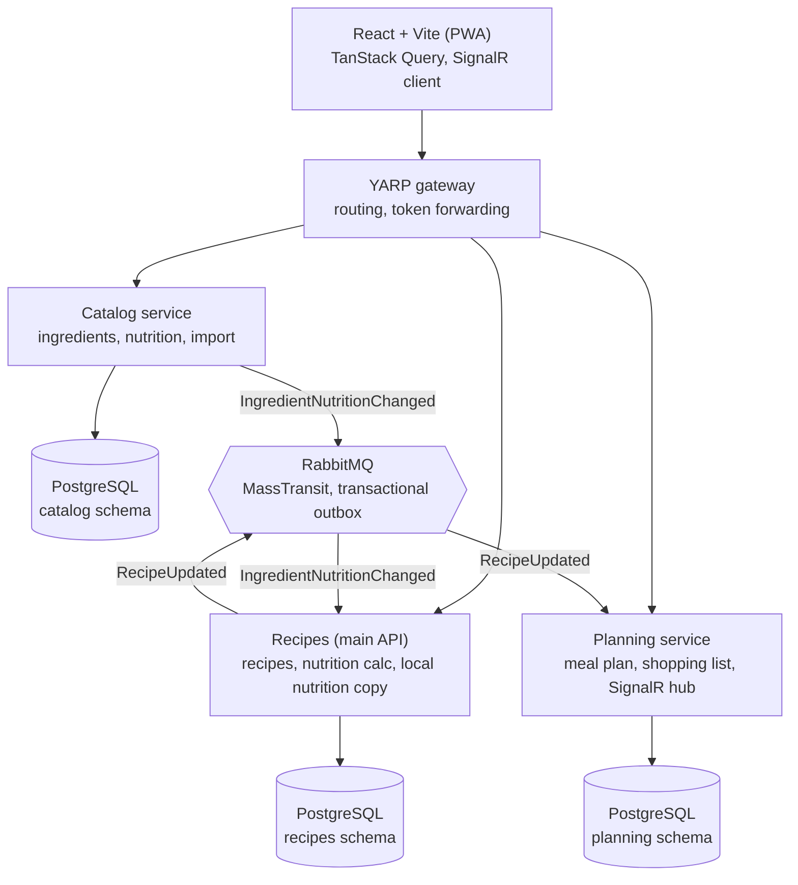

# Architecture and milestones

The first usable version ships in about 4 evenings as a modular monolith (M0–M3). After that come
reliability work, real-time features and the extraction into services, so there is always a working,
demoable state.

## Scope

**v1 features**

- Ingredient catalog with nutrition values per 100 g, imported from an open database
- Recipes with ingredients, servings and steps; calories and macros per serving calculated automatically
- Weekly meal plan: recipes assigned to days and meals
- Shopping list generated from the meal plan, quantities merged across recipes with unit conversion,
  items can be checked off

**What it should demonstrate in interviews:** full-stack thinking, deliberate EF Core usage,
justified (not reflexive) microservice decisions, modern React data handling, testing and observability.

## Tech stack

| Area | Choice | Why it is worth showing |
| --- | --- | --- |
| Backend | ASP.NET Core Minimal APIs, .NET 10 | Little boilerplate, endpoint groups per module |
| Database | PostgreSQL, EF Core 10 (Npgsql) | JSON columns, schema per module, migrations |
| Orchestration | .NET Aspire | One command starts everything; dashboard with logs and traces |
| Messaging | RabbitMQ + MassTransit v8 or Wolverine | Outbox, retries, idempotency (check current licence terms) |
| Gateway | YARP | Single entry point for the frontend |
| Real-time | SignalR | Shared shopping list with live sync |
| Auth | ASP.NET Core Identity + JWT | Familiar base, easy to explain; gateway and services validate the JWT |
| Frontend | React 19, TypeScript, Vite | Type-safe client |
| Data handling | TanStack Query, React Hook Form + Zod | Caching, optimistic updates, validation |
| API client | Generated from OpenAPI (Orval) | Backend and frontend types never drift |
| UI | Tailwind + shadcn/ui | Fast, polished UI |
| Tests | xUnit, Testcontainers, Vitest, Playwright | Integration tests against a real database |
| Observability | OpenTelemetry | Distributed traces across services |
| CI/CD | GitHub Actions, Docker | Build, test, image on every push |

No MediatR or AutoMapper: plain handler classes and explicit mapping. A deliberate, explainable choice.

## Architecture

v1 is a modular monolith: one API host loads all three modules, sharing one database but each module
in its own schema. In v2, Catalog and Planning become separate services, the frontend reaches them
through a YARP gateway, and services keep their data in sync through RabbitMQ events.

Services do not call each other synchronously: each works from its own schema and keeps an
event-fed copy of the data it needs from the others.

## Modules and service boundaries

| Module | Responsibility | Owns | Extracted in v2 |
| --- | --- | --- | --- |
| Catalog | Ingredients, nutrition values, unit data (density, piece weight), data import | Ingredient, NutrientProfile | Yes: own service, publishes an event when nutrition changes |
| Recipes | Recipes, ingredients, serving scaling, nutrition totals | Recipe, RecipeIngredient, local nutrition copy | Stays in the main API |
| Planning | Weekly plan, shopping list, check-off, real-time sync | MealPlan, ShoppingList, ShoppingItem | Yes: own service with a SignalR hub |

**Communication between services**

- Recipes does not call Catalog synchronously. It keeps its own copy of nutrition values from
  `IngredientNutritionChanged` events (eventual consistency; Catalog being down does not stop recipes).
- Planning keeps recipe ingredients up to date from `RecipeUpdated` events, so generating a shopping
  list needs no synchronous call.
- Every event leaves through a transactional outbox; consumers are idempotent.

**Why exactly these two extractions:** Catalog's import is heavy, infrequent batch work; Planning is
real-time with many short requests. Different load profiles make separate scaling and deployment worthwhile.

## Domain model and EF Core

The hard part is units: "2 tbsp olive oil" converts to grams only via density, "3 eggs" only via
piece weight. Nutrition calculation and shopping-list merging both build on this.

**Main types**

- `Ingredient`: name, `NutrientProfile` per 100 g (kcal, protein, fat, carbs, fibre), optional density (g/ml) and piece weight (g)
- `Recipe`: title, servings, steps, tags, list of `RecipeIngredient`
- `RecipeIngredient`: join entity with payload: `Quantity` (amount + unit) and a note
- `MealPlan`: week, entries (day, meal, recipe, servings)
- `ShoppingList` / `ShoppingItem`: ingredient, merged quantity, checked flag, who checked it
- `Quantity`, `NutrientProfile`: value objects, immutable records with their own conversion and addition logic

| EF Core technique | Where | What it shows |
| --- | --- | --- |
| Complex / owned types | `Quantity`, `NutrientProfile` | DDD value objects without extra tables |
| JSON column | Recipe steps, tags | When document-style storage fits in a relational DB |
| Many-to-many with payload | `RecipeIngredient` | Configuring an explicit join entity |
| Global query filter | Soft delete, household filter | Multi-tenancy and the risk of disabling filters |
| Concurrency token | `ShoppingItem` (Postgres `xmin`) | Optimistic concurrency, handling 409 in the frontend |
| SaveChanges interceptor | Audit fields, outbox messages | Cross-cutting logic without polluting the domain |
| Projection + `AsNoTracking` | Recipe list, search | Avoiding N+1, selecting only needed columns |
| Split query | Recipe details with many ingredients | Awareness of cartesian explosion |
| Schema per module, multiple DbContexts | All three modules | Enforcing module boundaries |
| Migration bundles | In CI, not at startup (only local Development migrates on start) | Safe schema updates |
| Seed + import | Curated USDA SR Legacy subset (ADR 0003) | Bulk insert, batch size |
| Compiled query | Ingredient search while typing | Performance awareness, backed by measurement |

Nutrition calculation is pure domain logic (`Recipe.CalculateNutrition()`), unit-testable without a database.

## Frontend (React)

Feature-based folders; server state is handled by TanStack Query, no global state manager.

**Pages:** recipe list with filters, recipe details (servings slider with live nutrition recalculation),
recipe editor, ingredient search, weekly plan view, shopping list (mobile-first).

**Showcase pieces**

- **Recipe editor:** React Hook Form `useFieldArray` for dynamic ingredient rows, Zod schema, debounced ingredient autocomplete
- **Shopping list:** optimistic update on check-off, rollback on error, 409 conflict handling
- **Real-time:** SignalR events written into the TanStack Query cache (`setQueryData`), so the list updates live on two phones
- **Offline:** PWA with a service worker; check-off works with poor reception in the shop and syncs on reconnect
- **Type safety:** hooks and types generated from the backend's OpenAPI description
- **Auth:** sign-in and registration with ASP.NET Core Identity, access + refresh tokens, protected routes
- **Tests:** Vitest + Testing Library for components, MSW-mocked API, Playwright e2e for the main flow

## Milestones

The first usable version is done within 4 evenings (M0–M3); the full, demoable v2 takes roughly
10–13 evenings. One evening = 3–4 hours. Every milestone ends in a working, committed state.

| Phase | Milestone | Content | Estimate |
| --- | --- | --- | --- |
| 1. v1 MVP | M0 – Foundations | Aspire, Postgres, Vite skeleton | 1 evening |
| | M1 – Ingredient catalog | Data import and search | 1 evening |
| | M2 – Recipes | CRUD, editor, nutrition | 1 evening |
| | M3 – Meal plan and shopping list | Weekly plan, generated list | 1 evening |
| | **Gate: v1 usable at home** | | |
| 2. Reliability | M4 – Tests and CI | Testcontainers, CI, ADRs | 1 evening |
| | M5 – Auth and household | Identity, query filter | 1–2 evenings |
| | M6 – Real-time list | SignalR, concurrency token | 1 evening |
| 3. Microservices | M7 – Service extraction | Catalog, Planning, RabbitMQ | 2–3 evenings |
| | M8 – Operations | OpenTelemetry, PWA, deploy | 1–2 evenings |
| | **Gate: v2 demoable in interviews** | | |

### M0 – Foundations
- [x] .NET 10 solution with the planned layout, Aspire AppHost and ServiceDefaults
- [x] PostgreSQL container from Aspire, three DbContexts with their own schemas
- [x] React + Vite + TypeScript, Tailwind, shadcn/ui, TanStack Query base
- [x] OpenAPI description and generated frontend client (Orval)
- [x] GitHub Actions: build for both sides

### M1 – Ingredient catalog
- [x] `Ingredient`, `NutrientProfile` complex type, migration
- [x] Import: a few hundred common ingredients from USDA SR Legacy, plus Hungarian names
- [x] Search endpoint with projection, frontend autocomplete

### M2 – Recipes
- [ ] `Recipe`, `RecipeIngredient`, `Quantity` value object with unit conversion, unit-tested
- [ ] CRUD endpoints, steps in a JSON column
- [ ] Recipe editor (React Hook Form + Zod), list and details pages
- [ ] Nutrition per serving, servings slider with live recalculation

### M3 – Meal plan and shopping list
- [ ] Weekly plan view, recipes assigned to days and meals
- [ ] Generate list with merged quantities, add manual items
- [ ] Check-off with optimistic update, mobile-friendly view

### M4 – Tests and CI
- [ ] Integration tests with Testcontainers, architecture test for module boundaries
- [ ] Vitest component tests, one Playwright e2e for the main flow
- [ ] First ADRs: modular monolith, PostgreSQL, no MediatR

### M5 – Auth and household
- [ ] ASP.NET Core Identity in its own Auth module, JWT access + refresh tokens, sign-in on the frontend
- [ ] Household entity, global query filter, tests for the filter

### M6 – Real-time list
- [ ] SignalR hub, events into the TanStack Query cache
- [ ] Concurrency token, 409 handled with a clear message

### M7 – Service extraction
- [ ] RabbitMQ in Aspire, integration events in the Contracts project
- [ ] Transactional outbox, idempotent consumers
- [ ] Catalog and Planning in their own hosts, YARP gateway in front
- [ ] Recipes' local nutrition copy fed by events

### M8 – Operations and polish
- [ ] OpenTelemetry traces, including across events
- [ ] PWA offline mode for the shopping list
- [ ] Docker images from CI, deploy (e.g. Azure Container Apps or own server)
- [ ] README with architecture diagram and demo data

## Interview demo

A 5-minute demo plus the reasoning behind decisions is worth more than a feature list.

**Demo flow**

1. Add a recipe: autocomplete, dynamic form, live nutrition
2. Change servings: nutrition and quantities recalculate
3. Finalise the weekly plan, generate the shopping list with merged quantities
4. List open in two browsers: check off in one, live update in the other
5. Aspire dashboard: one request traced from the gateway through the event to the Planning service

**Questions to prepare for**

- Why not microservices for everything? What would a monolith have cost?
- What happens if RabbitMQ goes down? What does the outbox do?
- How do you handle receiving the same event twice?
- Why does Recipes keep a copy of nutrition data, and how stale can it get?
- What happens if two people edit the same item at once?
- How could the household filter be disabled by accident, and how do you prevent it?
- How would you roll out migrations on a live system without downtime?
- Why TanStack Query and not Redux?

Every answer should be backed by an ADR in `docs/adr`, so you can point to this repo instead of
answering in the abstract.
